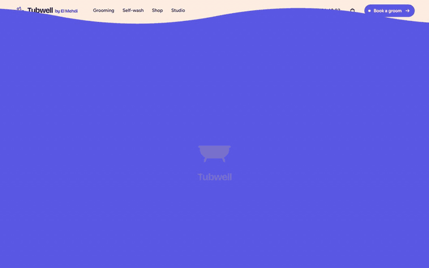
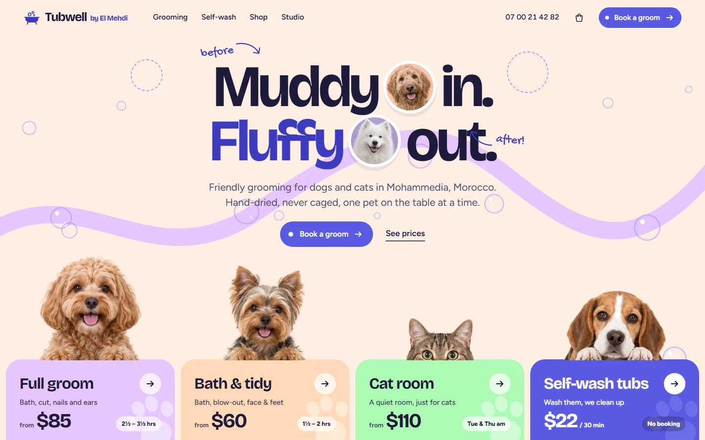
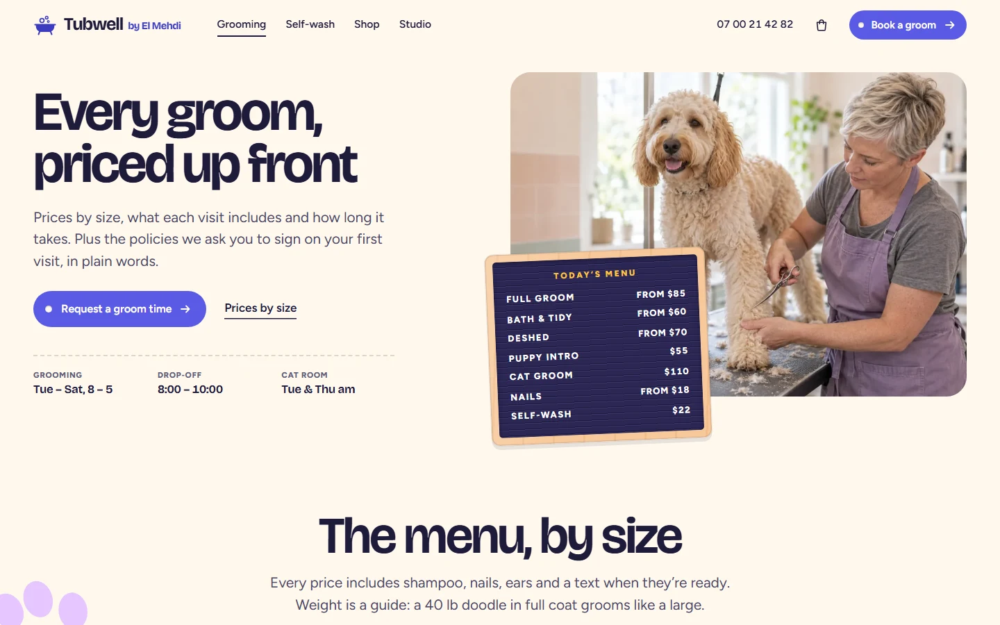
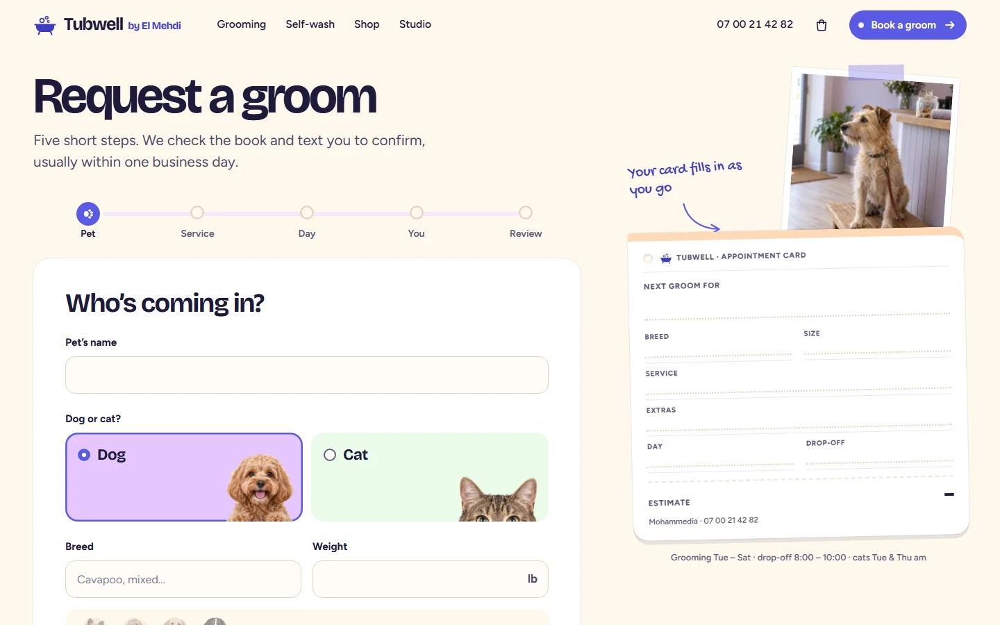
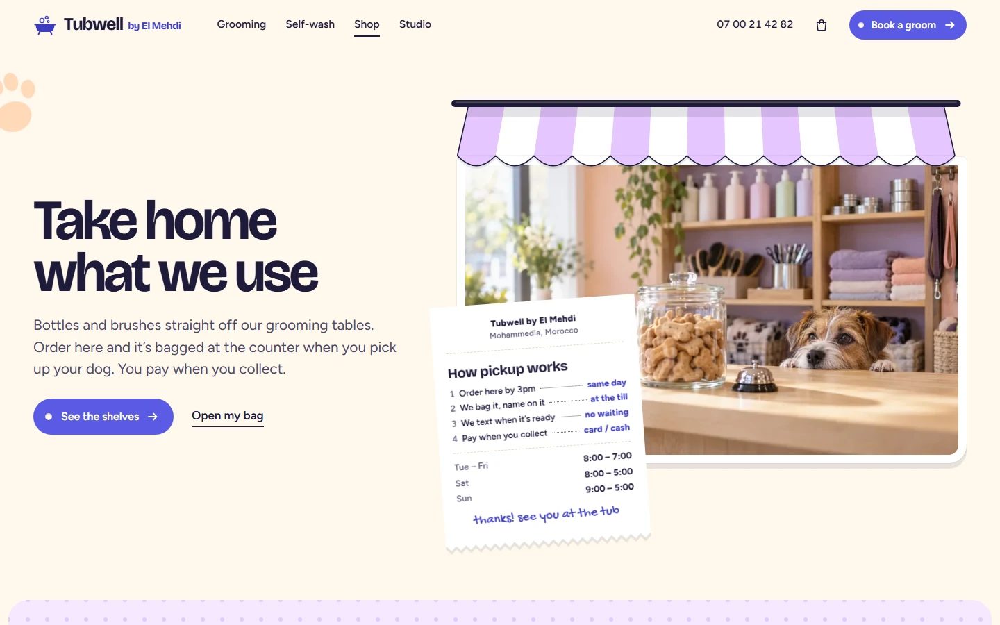
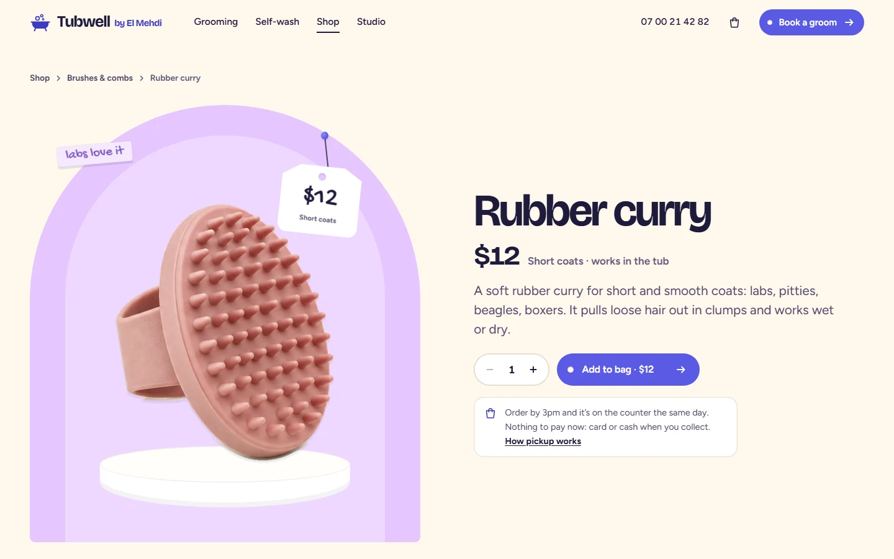
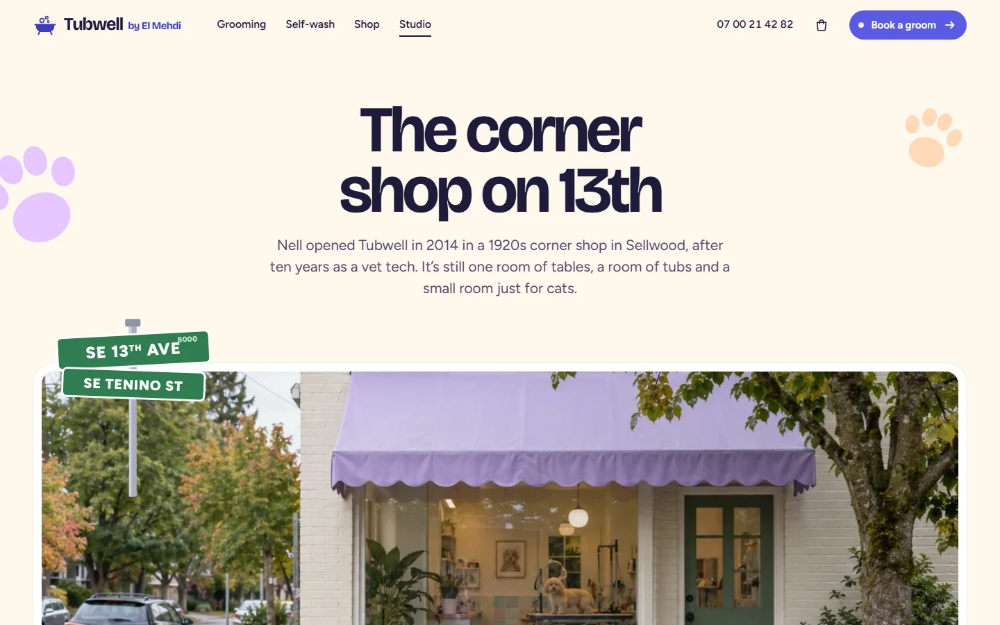
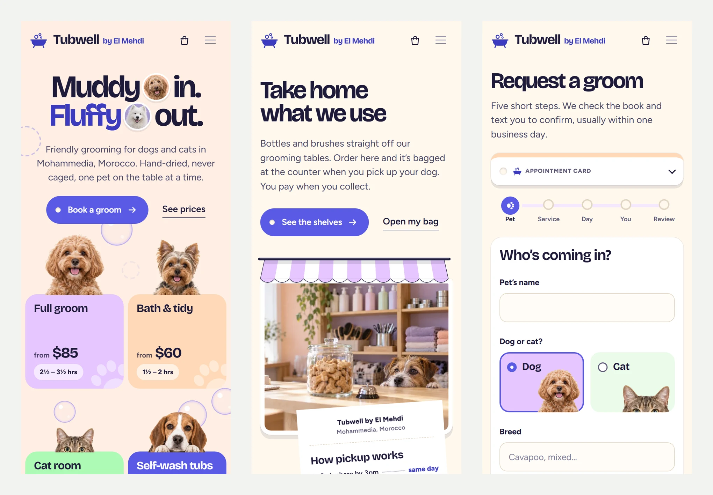

<div align="center">

# Tubwell by El Mehdi

### A dog & cat grooming studio website: prices by size, a booking request, a pickup shop and a studio tour

21 pages with page transitions, a size picker that reprices the whole menu, a five-step booking form with a live appointment card,<br>
and a pickup shop with a bag drawer and checkout. Responsive, self-hosted assets, deployed on Netlify.

[](https://tubwell-by-elmehdi.netlify.app/)


<br>

<a href="https://tubwell-by-elmehdi.netlify.app/"></a>

</div>

<br>

## ✦ Highlights

- **"Muddy in. Fluffy out." hero**: pets peek over four service cards, soap bubbles float past, and a first-visit loader and page transitions tie the pages together
- **Prices by size**: pick Small, Medium, Large or Giant and every price tag on the line updates (a full groom goes from $105 to $130 for a large dog)
- **Five-step booking request**: pet, service, day, you, review, with an appointment card beside the form that fills in as you answer, inline validation and a confirmation screen
- **Pickup shop**: 13 products with filters (brushes & combs, treats, cats), product pages with quantity, a bag drawer that remembers its items in the browser, and a checkout with inline errors and a "here's what happens next" screen
- **Grooming menu**: a letterboard price list, a drag-to-compare before/after slider, extras and the policies in plain words
- **Self-wash and studio**: a "take a number" ticket for the tubs, the corner storefront, a drawn floor plan and the team rota
- **Live details**: an "open now" line worked out from the opening hours on Morocco time, plus `aria-live` updates for the bag and forms and `prefers-reduced-motion` support
- **Static hosting**: no server to run; one Netlify Function answers the forms, a custom 404 page, `/x` → `/x/` redirects and immutable caching for theme assets

<br>

## ✦ Screenshots

<table>
  <tr>
    <td width="50%"><p align="center"><b>Home</b>: muddy in, fluffy out</p></td>
    <td width="50%"><p align="center"><b>Grooming</b>: the menu, priced up front</p></td>
  </tr>
  <tr>
    <td width="50%"><p align="center"><b>Book</b>: five steps and a live appointment card</p></td>
    <td width="50%"><p align="center"><b>Shop</b>: order online, collect at the counter</p></td>
  </tr>
  <tr>
    <td width="50%"><p align="center"><b>Product</b>: rubber curry</p></td>
    <td width="50%"><p align="center"><b>Studio</b>: the corner shop</p></td>
  </tr>
</table>

### On phone

<p align="center"></p>

<br>

## ✦ Pages

| Page | What's on it |
|---|---|
| `/` | Hero with service cards, size picker and price tags, the day at the studio, regulars, rules poster, self-wash station, shop rail, visit info |
| `/grooming/` | Letterboard menu, full menu by size, extras, before/after slider, policies, self-wash "take a number" |
| `/book/` | Five-step booking request with a live appointment card and confirmation |
| `/shop/` + 13 product pages | Shop window, filters, shelves, product pages, bag drawer and pickup checkout |
| `/studio/` | Storefront, floor plan, team rota, address and a contact postcard |
| `/privacy/` · `/terms/` | Legal pages with a table of contents |
| `/404.html` | Custom "page not found" |

<br>

## ✦ Stack

- **Pages**: HTML, CSS and vanilla JavaScript, built with a custom WordPress + Elementor theme and published as static files
- **Fonts**: Bricolage Grotesque and Figtree, self-hosted
- **Hosting**: Netlify (`netlify.toml`), with `netlify/functions/request.mjs` for the booking and bag forms
- **Local preview**: `scripts/serve.mjs` (Node, no dependencies)

<br>

## ✦ Getting started

```bash
git clone https://github.com/elmehdi-sekrare/tubwell-by-elmehdi.git
cd tubwell-by-elmehdi
npm start            # http://localhost:5332
```

Node 18+. There is nothing to install: `scripts/serve.mjs` serves `site/` the way Netlify does (`/x` → `/x/`, the 404 page)
and answers the forms like the Netlify Function.

<br>

## ✦ Deploy

Connect the repo in Netlify, leave the build settings empty, and name the site `tubwell-by-elmehdi`.
`netlify.toml` publishes `site/` as it is, routes the forms to the function and sets the headers (noindex, nosniff, caching).
The forms run in demo mode: nothing is stored or sent.

<br>

## ✦ Project structure

```
site/                     21 pages + theme assets (CSS, JS, fonts, images)
netlify/functions/        request.mjs: answers the booking and bag forms
scripts/serve.mjs         local preview
docs/                     README screenshots and preview
netlify.toml              publish folder, form route, headers
```

<br>

## ✦ Contact

[](https://www.linkedin.com/in/el-mehdi-sekrare-77000629b)
[](mailto:elmehdisekrare@gmail.com)
[](https://github.com/elmehdi-sekrare)

---

<sub>Based on the Tubwell template by Visuvate.</sub>
